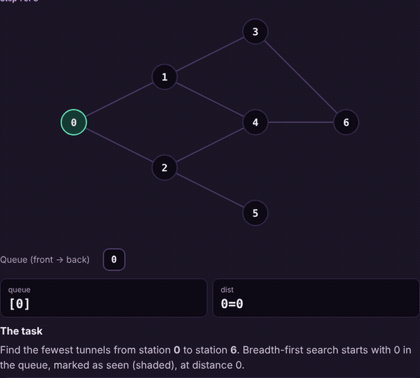
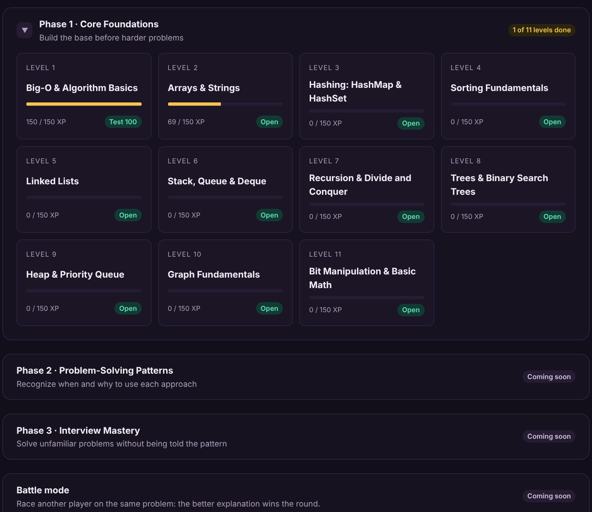
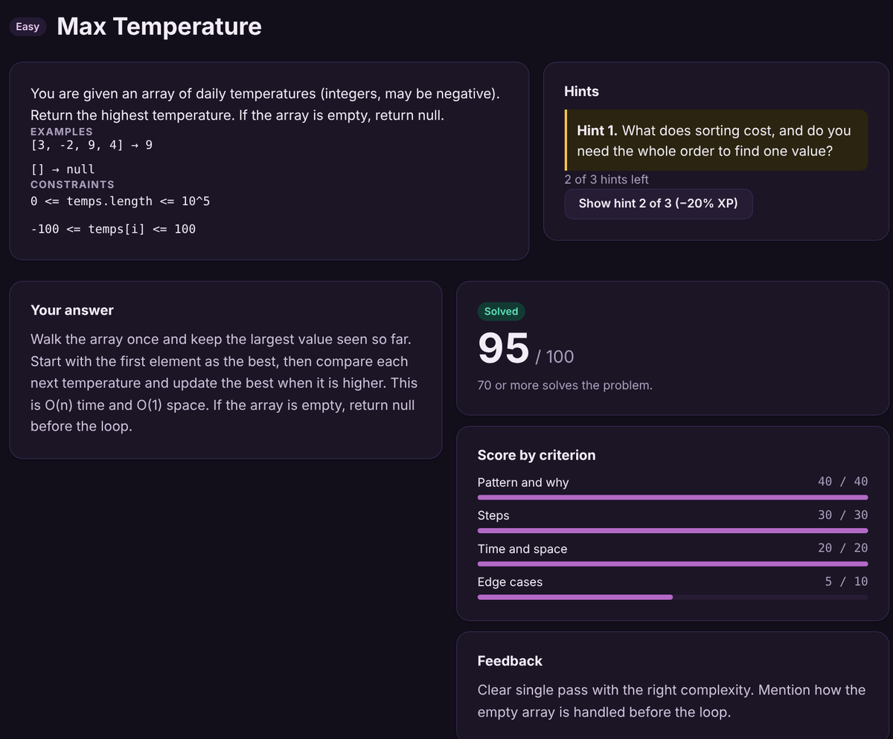
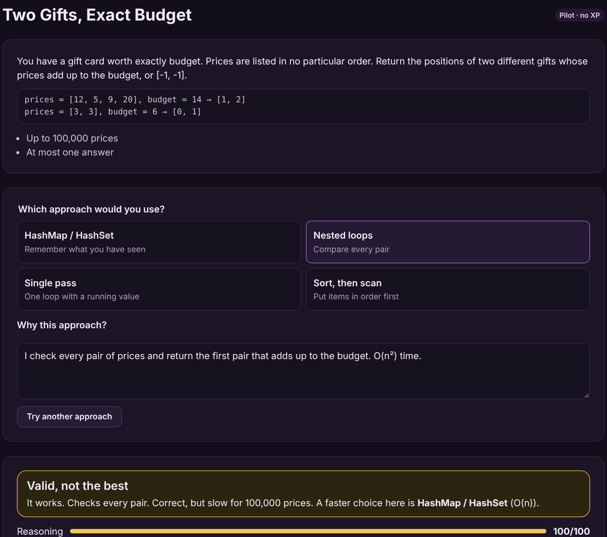
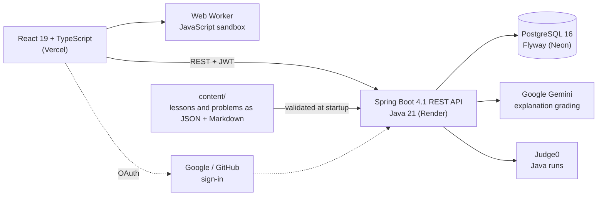

# AlgoQuest

**Don't let Algorithm beat you.**

A web app for learning the algorithm patterns used in coding interviews. Topics are levels ordered from easy to hard. Each level has an animated lesson and problems, and you **explain your approach in words**, the way you would in an interview. An AI grades the explanation against a teacher-written answer key; writing the code afterwards is optional and doubles your points.

**[Try the live app](https://algoquest-murex.vercel.app)**: choose *Try the demo* to open every level without an account. The free backend sleeps when idle, so the first request can take about a minute.



> **Status: Phase 2 under way.** Levels 1–13 are playable, from Big-O to graphs, two pointers and sliding windows. Current checkpoint: [docs/STATUS.md](docs/STATUS.md).

## What it does

| | |
| --- | --- |
|  | **A learning path of 27 levels in three phases.** Each level unlocks after the previous level's timed test. Phase 1 covers arrays, hashing, sorting, linked lists, stacks and queues, recursion, trees, heaps, graphs, and bit manipulation ([curriculum map](docs/CURRICULUM-MAP.md)). |
|  | **Explain in words, graded by AI.** Google Gemini scores the explanation on the pattern, the steps, time and space, and edge cases against a teacher-written answer key, and gives one line of feedback. Hints cost XP; a practice round and a level-up test follow. |
|  | **Pattern challenges.** Pick an approach for a real-world scenario and say why; then compare every approach's time, space, and trade-offs. |

Also: step-by-step walkthroughs with predictions for arrays, linked lists, trees, heaps and graphs, with Play and Pause; template code in JavaScript and Java; optional code against hidden tests (JavaScript in a browser sandbox, Java on Judge0); XP, a daily streak and a profile; English and Vietnamese; roles, an admin panel and an audit log.

## How it is built



**Engineering highlights**

- **Content as data, checked like code.** Lessons, walkthroughs and problems live in `content/` as JSON and Markdown. A validator rejects bad content at startup and in CI (for example, a graph edge to a missing vertex). Every hidden test answer is computed by two reference solutions, in JavaScript and Java, and a replay test checks each walkthrough against a reference algorithm.
- **AI grading with guardrails.** The grader gets the answer key and a fixed rubric, returns structured scores, and fails closed: a timeout or quota error never costs the player XP. A separate workflow measures the real model against sample explanations.
- **Sandboxed code runs.** JavaScript runs in a Web Worker with a time limit, with `ListNode` and `TreeNode` helpers; Java runs on Judge0 with a daily cap.
- **Permissions, not role names.** The backend checks named permissions; roles are bundles of them. Admin actions are written to an audit log. Visitors get a capped, temporary demo role.
- **Tested end to end.** 206 backend tests against a real PostgreSQL, about 120 frontend tests, and a Playwright smoke run of production builds on every change; over 50 recorded decisions and a report per sprint.

## Stack

React 19 + Vite + TypeScript frontend, Spring Boot 4.1 (Java 21) REST API, PostgreSQL with Flyway. AI grading with Google Gemini. JavaScript answers run in a Web Worker in the browser; Java answers run on Judge0 when `JUDGE0_API_KEY` is set (D-054). Hosted on Vercel (frontend), Render (backend), and Neon (database).

Screenshots were taken on 2026-11-20.

## Run locally

You need Git, [Docker Desktop](https://www.docker.com/products/docker-desktop/), Java 21, and Node.js 22.

1. **Settings.** Copy the example file and fill in the values you have (Google or GitHub sign-in keys are needed to sign in locally):

   ```bash
   cp .env.example .env        # Windows: copy .env.example .env
   ```

2. **Database.** Start PostgreSQL 16 in Docker:

   ```bash
   docker compose up -d
   ```

3. **Backend** (API on <http://localhost:8080>; check <http://localhost:8080/actuator/health>):

   ```bash
   cd backend
   ./mvnw spring-boot:run      # Windows: mvnw.cmd spring-boot:run
   ```

   The first run downloads Maven and the dependencies, which takes a few minutes.

4. **Frontend** (in a second terminal; app on <http://localhost:5173>):

   ```bash
   cd frontend
   npm ci
   npm run dev
   ```

The shared components are shown at <http://localhost:5173/ui-kit>.

### Checks

| Part | Command | Notes |
| --- | --- | --- |
| Backend | `./mvnw verify` in `backend/` | Formatting, tests, build; tests start their own database, so Docker must be running |
| Frontend | `npm run lint`, `npm run format:check`, `npm run typecheck`, `npm test`, `npm run build` in `frontend/` | Same steps as CI |
| Records | `node scripts/check-records.mjs` | Links, IDs, and record style (D-038) |
| Real grader | `./mvnw test -Dtest='RealGraderCheck,RealPatternGraderCheck' -DexcludedGroups=none` in `backend/` (Windows: `mvnw.cmd`) | Calls Gemini with `GEMINI_API_KEY` from `.env`: prints scores and latency for sample explanations and pattern answers (about 2 minutes; uses about 11 free-tier requests). In CI: run the `grader-check` workflow by hand; it reads the `GEMINI_API_KEY` repository secret |
| Smoke | `smoke` workflow on GitHub Actions | Production builds, Postgres, and Playwright end to end with a fake grader |

To stop the database: `docker compose down` (add `-v` to delete its data).

## Documentation

| Document | What it covers |
| --- | --- |
| [SRS](docs/SRS.md) | Product definition and requirements |
| [Architecture](docs/ARCHITECTURE.md) | Components, UML views, data model |
| [Decisions](docs/DECISIONS.md) | Approved and proposed decisions |
| [Backlog](docs/BACKLOG.md) | Sprint roadmap and tasks |
| [Workflow](docs/WORKFLOW.md) | Branching, reviews, engineering profile |
| [Tools](docs/TOOLS.md) | Services, free-tier limits, dev tools |
| [Content guide](docs/CONTENT-GUIDE.md) | How lessons and problems are written |
| [Curriculum map](docs/CURRICULUM-MAP.md) | How the original 17 levels map to the 27-level curriculum; fixed level numbers |
| [Multilingual content](docs/MULTILINGUAL-CONTENT.md) and [i18n foundation](docs/I18N-FOUNDATION.md) | Vietnamese lesson files and UI translation |
| [Status](docs/STATUS.md) and [sprint reports](docs/reports/) | Current checkpoint and what each sprint delivered |
| [Deployment](docs/DEPLOY.md) | Hosting setup, live smoke check, rollback |

## Grading test

[`tools/grading-test`](tools/grading-test) was used before grading was built to check that a free AI model scores sample explanations close to the expected scores (T-005). The `grader-check` workflow now does the same check against the real grader.
