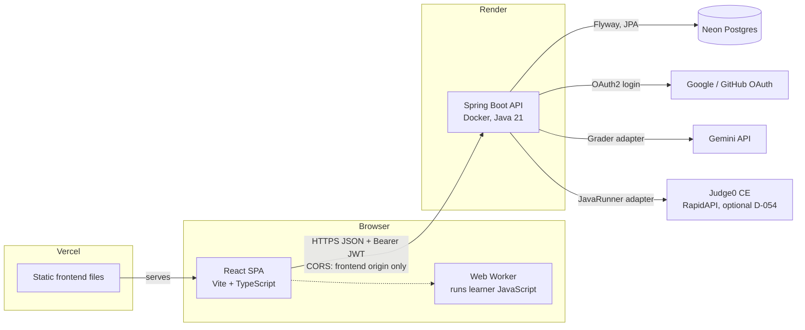
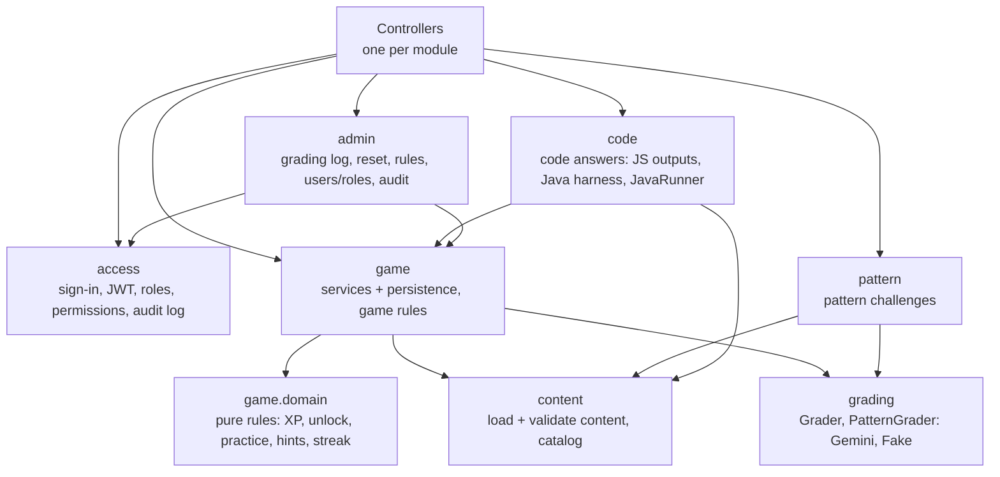
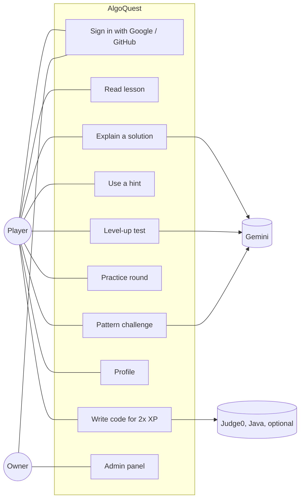
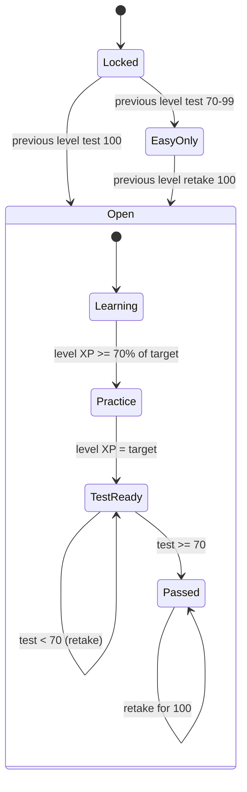
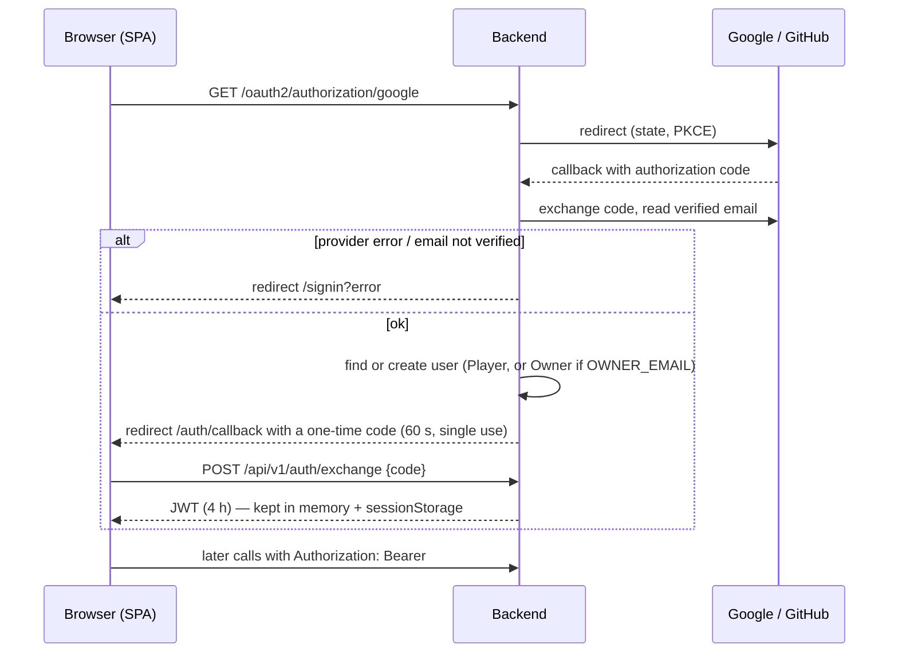
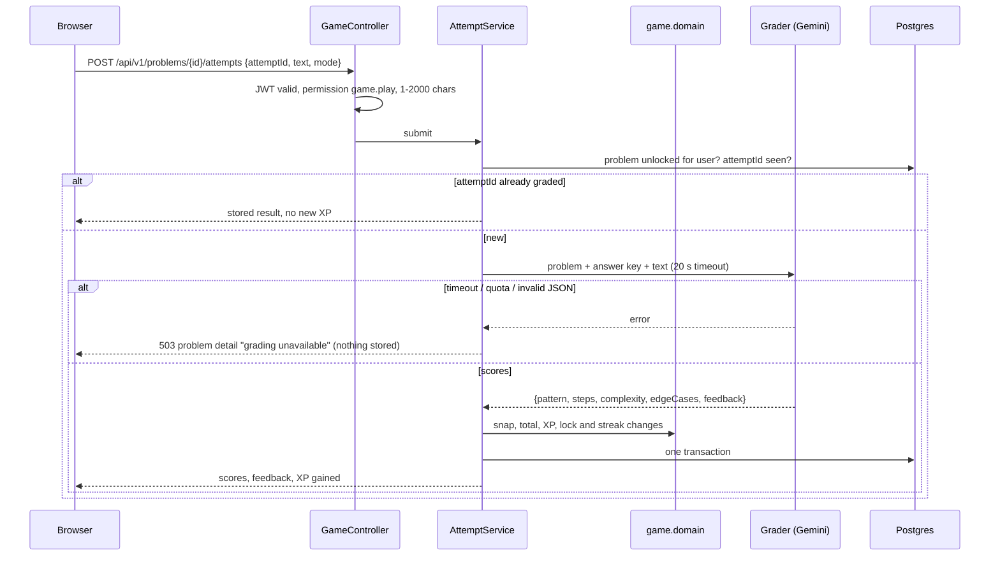
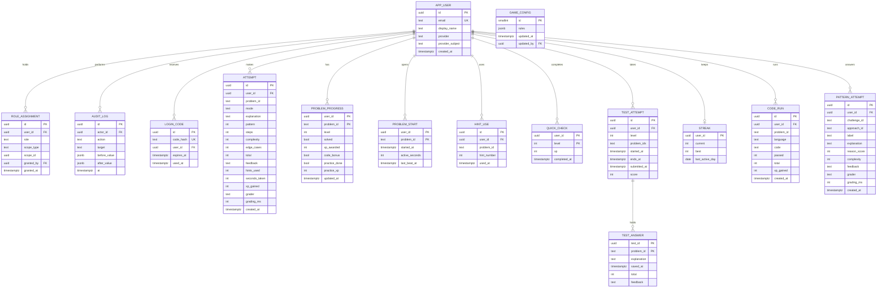
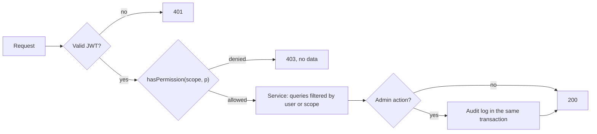

# Architecture — AlgoQuest

| Field | Value |
| --- | --- |
| Version | 1.1 (updated 2026-11-20 to match the code after Sprint 10) |
| Status | **Approved baseline** — PO, 2026-11-06 (T-002) |
| Requirements baseline | [SRS.md](SRS.md) v1.0 |

Diagrams are Mermaid source in this file; GitHub renders them and this file is their single editable source.

## 1. Overview and Deployment



**Selected style: API-first modular monolith** (D-030). One Spring Boot application split into feature modules with strict boundaries, and a separate React single-page app that only talks to the versioned REST API (`/api/v1`). A future mobile app or organization dashboard uses the same API. A module can be extracted into its own service later because modules only talk through their public service interfaces.

Hosting (D-037): Vercel Hobby, Render free web service (sleeps after 15 minutes idle, about a minute to wake), Neon Free. The frontend shows a "waking the server" screen while the first request is slow.

Rejected: Next.js + Supabase (option A) — faster to start but harder to extend for organizations and other clients; microservices — no benefit at this size.

## 2. Repository Layout

```text
algoquest/
  frontend/            React 19 + Vite + TypeScript SPA (src/i18n: English and Vietnamese UI text)
  backend/             Spring Boot 4.1 (Java 21, Maven)
  content/             levels.json, then one folder per level: lesson, walkthrough, quick check,
                       intuition question, problems (with answer keys and hidden tests), pattern
                       challenges, and locales/vi translations
  e2e/                 Playwright smoke test
  scripts/             records check (D-038)
  tools/grading-test/  grading accuracy test (T-005)
  docs/                project records
  docker-compose.yml   local Postgres
  render.yaml          Render service definition
  .github/workflows/   backend, frontend, docs, smoke, grader-check
```

`content/` is packaged into the backend image at build time (D-033). Answer keys and hidden test outputs are only ever read by the backend.

## 3. Backend Modules (package `com.algoquest`)



| Module | Responsibility | Owns (tables / data) |
| --- | --- | --- |
| `access` | OAuth2 sign-in (Google, GitHub), one-time login codes, JWT issuing and validation, users, role assignments with scope, permission catalogue, `PermissionEvaluator`, audit log, smoke-test sign-in | `app_user`, `login_code`, `role_assignment`, `audit_log` |
| `content` | Load `content/` at startup, validate it (startup fails on invalid content), expose a read-only catalog; public views never include answer keys or hidden outputs | In-memory catalog |
| `game.domain` | Pure Java rules with no Spring or I/O: problem XP (FR-08), level target, lock states (FR-10), practice gate (FR-09), hint quota (FR-06), streak (FR-13) | Nothing |
| `game` | Use cases: attempts, hints, practice, active time, quick check, level-up tests, profile; game rules with file defaults and validated database overrides (`GameRulesService`) | `attempt`, `problem_progress`, `problem_start`, `hint_use`, `quick_check`, `test_attempt`, `test_answer`, `streak`, `game_config` |
| `pattern` | Pattern Recognition pilot (D-057): list challenges, record an answer, compare approaches; the content label decides correctness and the AI grades only the reason; no XP; 5 answers per challenge per day | `pattern_attempt` |
| `grading` | `Grader` and `PatternGrader` interfaces; `GeminiClient` (shared call, JSON schema, 20 s timeout); `GeminiGrader` and `GeminiPatternGrader` (prompts, score snapping); fakes for tests and smoke runs | Grading prompts |
| `code` | Code answers (FR-07): JavaScript outputs checked against hidden tests (D-035); Java through `JavaHarness` and the `JavaRunner` adapter (`Judge0Runner`, off without a key, D-054); `ListNode` and `TreeNode` arguments (D-058, D-059); daily Java quota | `code_run` |
| `admin` | Admin endpoints; every one guarded by a permission and audit-logged | Nothing |
| `shared` | RFC 9457 error handling (`ApiException`), clock configuration | Nothing |

**Rules:** controllers are thin (validate, authorize, call one service). Modules call each other only through public service classes, never another module's repositories. `game.domain` depends on nothing. **Authorization happens in controllers/services through `access`; the domain never checks permissions** (NFR-10). Errors use RFC 9457 problem details; no stack traces or keys in responses.

**State ownership:** the database owns progress. Each graded attempt is one transaction (attempt + XP + progress + streak), idempotent by a client-generated `attemptId`, so a retry never awards XP twice (NFR-09).

## 4. Frontend Structure

| Folder | Content |
| --- | --- |
| `src/api` | Typed API client, JWT handling (memory + `sessionStorage`, D-036), retry and "waking the server" state, `useApiGet` |
| `src/auth` | Sign-in page, OAuth callback (exchanges the one-time code), route guard, session |
| `src/components` | Shared UI: header, footer, buttons, cards, XP bar, badges, chips, modal, celebration, loading, error, and waking states |
| `src/pages` | Learning path (home), level page, profile, VIP placeholder, UI kit, not found |
| `src/lesson` | Five-step lesson: Markdown renderer (own parser, no raw HTML), walkthrough with cell, linked-node, and tree views, predictions, quick check, JavaScript/Java tabs |
| `src/solve` | Solve page: explanation form, feedback, hints, timer, scoring guide |
| `src/code` | Code editor with highlighting, code panel, JavaScript Web Worker with `ListNode`/`TreeNode` helpers |
| `src/leveltest` | Level-up test |
| `src/pattern` | Pattern challenge list and page |
| `src/admin` | Admin panel (rendered only with admin permissions; the backend still enforces) |
| `src/game` | Shared game state (levels, rules) |
| `src/i18n` | UI text in English and Vietnamese (localization track) |
| `src/theme`, `src/styles`, `src/config` | Light/dark theme, design tokens, site name (`VITE_APP_NAME`) |
| `src/test` | Test helpers: fake API, game data, render helper |

React Router for pages; a small `fetch` wrapper plus hooks for data (no state library). No third-party editor or Markdown library: both are small in-house components.

## 5. Design Patterns

| Pattern | Problem it solves | Simpler alternative | Tradeoff |
| --- | --- | --- | --- |
| Adapter (`Grader`, `PatternGrader`, `JavaRunner`) | Providers may change; tests and smoke runs need fakes | Call Gemini/Judge0 directly in services | One interface each; failure paths become testable |
| Language paths in `CodeService` | JavaScript runs in the browser and only its outputs are checked; Java runs on Judge0 | One generic remote runner for both | JavaScript costs the server nothing; Java needs a key and a daily quota |
| Permission evaluator (Spring `@PreAuthorize("hasPermission(...)")`) | Same check style for global permissions now and organization scopes later | `if (user.isAdmin())` checks | Slight indirection; organizations add scopes without rewriting checks |

## 6. UML Views and Why They Were Selected

| View | Why |
| --- | --- |
| Deployment / overview (§1) | Five external systems and a cold-starting backend |
| Module dependencies (§3) | Boundaries that keep organizations from touching the game |
| Use case (§6.1) | System boundary and actors |
| State diagram (§6.2) | Level progression is the core lifecycle |
| Sequence: sign-in (§6.3) | OAuth plus our own JWT is security-critical |
| Sequence: grading (§6.4) | The critical interaction, with several failure paths |
| ER diagram (§8) | Uniqueness rules prevent double XP |
| Authorization flow (§9.2) | Every endpoint must follow the same path |

### 6.1 Use cases



### 6.2 Level lifecycle (FR-02, FR-09, FR-10)



Level 1 starts Open. An Easy-only level can also reach its practice round and test from its Easy problems (approved in T-002).

### 6.3 Sign-in (FR-01)



Only the short one-time code appears in a URL, never the JWT. The JWT holds the user ID only; permissions are looked up per request, so a role change takes effect immediately.

### 6.4 Grading an explanation (FR-05, FR-08)



## 7. API (v1)

| Method | Path | Permission | Requirement |
| --- | --- | --- | --- |
| GET | `/oauth2/authorization/{google\|github}` | — | FR-01 |
| POST | `/api/v1/auth/exchange` | — (one-time code) | FR-01 |
| GET | `/api/v1/me` | signed in | FR-01, FR-17 |
| GET | `/api/v1/rules` | `game.play` | FR-08, FR-18.3 |
| GET | `/api/v1/levels` | `game.play` | FR-02 |
| GET | `/api/v1/levels/{n}/lesson` | `game.play` | FR-03 |
| POST | `/api/v1/levels/{n}/quick-check` | `game.play` | FR-03 |
| GET | `/api/v1/levels/{n}/problems` | `game.play` | FR-04 |
| GET | `/api/v1/problems/{id}` | `game.play` | FR-04 |
| POST | `/api/v1/problems/{id}/heartbeat` | `game.play` | FR-08 (active time) |
| POST | `/api/v1/problems/{id}/restart` | `game.play` | FR-08 |
| POST | `/api/v1/problems/{id}/attempts` | `game.play` | FR-05, FR-08, FR-09 |
| GET | `/api/v1/problems/{id}/hints` | `game.play` | FR-06 (hints already opened) |
| POST | `/api/v1/problems/{id}/hints` | `game.play` | FR-06 |
| GET | `/api/v1/hints/quota` | `game.play` | FR-06 |
| GET | `/api/v1/problems/{id}/code` | `game.play` | FR-07: hidden inputs, list and tree arguments, Java availability (D-035, D-058, D-059) |
| POST | `/api/v1/problems/{id}/code` | `game.play` | FR-07: check JavaScript outputs or run Java |
| POST | `/api/v1/levels/{n}/tests` | `game.play` | FR-10 |
| GET | `/api/v1/tests/{id}` | `game.play` | FR-10 |
| POST | `/api/v1/tests/{id}/answers` | `game.play` | FR-10 |
| POST | `/api/v1/tests/{id}/submit` | `game.play` | FR-10 |
| GET | `/api/v1/profile` | `game.play` | FR-12, FR-13 |
| GET | `/api/v1/levels/{n}/patterns` | `game.play` | D-057 |
| GET | `/api/v1/patterns/{id}` | `game.play` | D-057 |
| POST | `/api/v1/patterns/{id}/answers` | `game.play` | D-057 |
| GET | `/api/v1/admin/attempts` | `admin.gradingLog.view` | FR-18.1 |
| GET | `/api/v1/admin/pattern-answers` | `admin.gradingLog.view` | FR-18.1, D-057 |
| POST | `/api/v1/admin/users/{id}/progress-reset` | `admin.progress.reset` | FR-18.2 |
| GET, PUT | `/api/v1/admin/game-rules` | `admin.config.edit` | FR-18.3 |
| GET | `/api/v1/admin/users` | `admin.users.view` | FR-18.4 |
| POST | `/api/v1/admin/users/{id}/roles` | `admin.roles.grant` | FR-17, FR-18.4 |
| DELETE | `/api/v1/admin/users/{id}/roles/{role}` | `admin.roles.grant` | FR-17, FR-18.4 |
| GET | `/api/v1/admin/audit-log` | `admin.auditLog.view` | FR-17.6 |
| GET | `/api/v1/notes?q=&tag=&level=` | `notes.manage` | D-074 |
| POST | `/api/v1/notes` | `notes.manage` | D-074 |
| GET, PUT, DELETE | `/api/v1/notes/{id}` (own notes only) | `notes.manage` | D-074 |
| GET | `/api/v1/notes/export` (zip of Markdown files) | `notes.manage` | D-074 |
| GET | `/test-login` | smoke profile only | Smoke test |
| GET | `/actuator/health` | — | Hosting |

The leaderboard (FR-14) has no endpoint yet (T-403). `game.allLevels` (Owner, D-055) changes what `/levels` and the play endpoints allow, rather than guarding an endpoint of its own.

## 8. Data Model (ER)



Schema changes only through Flyway migrations. `PROBLEM_PROGRESS (user_id, problem_id)` being unique stops double XP. `ROLE_ASSIGNMENT.scope_type`/`scope_id` are empty in this release (§9.3). `AUDIT_LOG` is append-only: a database trigger rejects updates and deletes. Level unlocks are derived from the best `TEST_ATTEMPT` score, so no separate level table is stored. `GAME_CONFIG` holds one row of rule overrides. Problems, lessons, and levels live in `content/`, so tables store their text IDs. `PATTERN_ATTEMPT.label` is copied from the content at answer time so the record stays readable if the content changes.

## 9. Security and Access Control

### 9.1 Permission catalogue (this release)

| Permission | Owner | Player | Admin (defined, empty until OQ-05) |
| --- | --- | --- | --- |
| `game.play` | ✓ | ✓ | — |
| `game.allLevels` (test access, D-055) | ✓ | | |
| `admin.gradingLog.view` | ✓ | | |
| `admin.progress.reset` | ✓ | | |
| `admin.config.edit` | ✓ | | |
| `admin.users.view` | ✓ | | |
| `admin.roles.grant` | ✓ | | |
| `admin.auditLog.view` | ✓ | | |
| `notes.manage` (own notes, D-074) | ✓ | | |

A user's permissions are the union of their role assignments. `admin.roles.grant` can only grant roles whose permissions the granter also holds. The first Owner comes from `OWNER_EMAIL`; the last Owner cannot be removed.

### 9.2 How a request is authorized



Other measures: CORS allows only the frontend origin; secrets only in Render/GitHub environment variables; repository queries always filter by the authenticated user (or, later, by an authorized scope); the database user has no superuser rights; the learner's text goes to Gemini inside a delimited block with an instruction to treat it as data; Java runs only in Judge0's sandbox; JavaScript runs only in the learner's own browser.

### 9.3 Adding organizations later (FR-19)

| Change | Where | Touches existing code? |
| --- | --- | --- |
| Tables `organization` (member limit), `membership` | New Flyway migration | No |
| Roles `orgAdmin`, `orgMember`; permissions such as `org.members.invite`, `org.progress.view` | `access` catalogue | Adds entries only |
| Organization-scoped role assignments | Existing `role_assignment` columns | No schema change |
| Scoped checks `hasPermission(org, 'org.progress.view')` | `access` `PermissionEvaluator` | Extends one class; existing annotations unchanged |
| Invitations, member-limit check, organization dashboard | New `org` module + new frontend feature folder | No |
| Organization admin reads members' progress | New read methods exposed by `game` services | Adds methods; existing ones unchanged |
| Game rules (`game.domain`, grading) | — | **Not touched** (NFR-10) |
